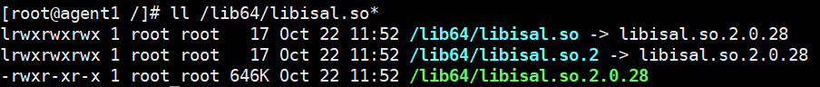
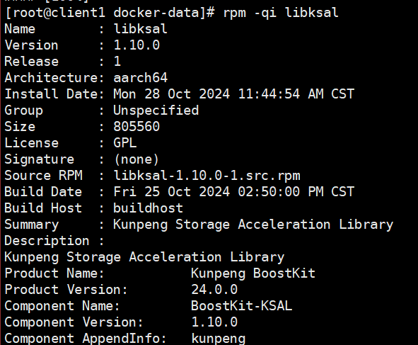
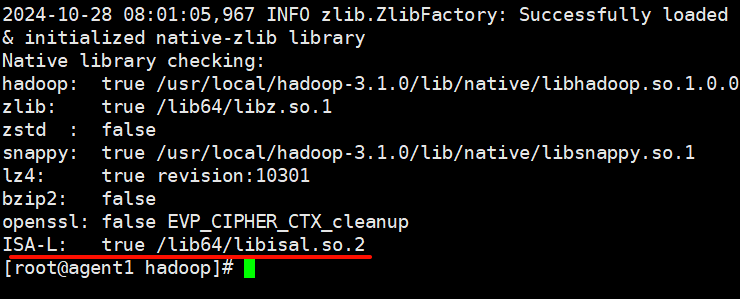

# 安装指南

## 环境要求

在安装SPDK之前，需要先安装KAE2.0，安装前请确保使用的环境满足KAE支持的软硬件环境，并且正确安装相应的License，License安装成功后，操作系统才能识别到加速器设备。

**硬件要求**

| 项目    | 规格                |
|-------|-------------------|
| CPU型号 | 鲲鹏920 5220处理器     |
| 硬盘    | 12 * 8TB SATA HDD |
| 网卡    | 4 * 25GE          |

**操作系统要求<a id="section10644173318346"></a>**

| 项目   | 版本                      |
|------|-------------------------|
| 操作系统 | openEuler 20.03 LTS SP3 |

**软件要求<a id="section1240364411598"></a>**

| 项目        | 版本     |
|-----------|--------|
| Hadoop    | 3.1.0  |
| KAE       | 1.3.11 |
| KSAL      | 1.10.0 |

## 节点信息

网段信息以实际为准。

| 主机类型     | 主机名称    | public网段         | Cluster网段        |
|----------|---------|------------------|------------------|
| namenode | server1 | 192.168.200.0/24 | 192.168.100.0/24 |
| datanode | agent1  | 192.168.200.0/24 | 192.168.100.0/24 |
| datanode | agent2  | 192.168.200.0/24 | 192.168.100.0/24 |
| datanode | agent3  | 192.168.200.0/24 | 192.168.100.0/24 |
| datanode | agent4  | 192.168.200.0/24 | 192.168.100.0/24 |
| datanode | agent5  | 192.168.200.0/24 | 192.168.100.0/24 |
| datanode | agent6  | 192.168.200.0/24 | 192.168.100.0/24 |
| datanode | agent7  | 192.168.200.0/24 | 192.168.100.0/24 |
| datanode | agent8  | 192.168.200.0/24 | 192.168.100.0/24 |
| datanode | agent9  | 192.168.200.0/24 | 192.168.100.0/24 |

## 安装KSAL算法包/KAE硬件卸载

**安装ISA-L**

1. 下载isa-l-2.28.0.tar.gz安装包。
2. 将安装包上传到/home目录下。
3. 执行一下命令对安装包进行解压。

    ```shell
   cd /home
   tar -zxf isa-l-2.28.0.tar.gz
   cd isa-l-2.28.0
   ```    
4. 编译安装。

    ```shell
   ./autogen.sh
   ./configure --prefix=/usr --libdir=/usr/lib64
   make
   make install
   make -f Makefile.unx
    ```
   
5. 确认安装情况。

   ```shell
   ll /lib64/libisal.so*
   ```

   

**安装KSAL**

1. 下载BoostKit-KSAL_1.10.0.zip安装包。
2. 将安装包上传到/home目录下。
3. 解压安装包。

   ```shell
   cd /home
   unzip BoostKit-KSAL_1.10.0.zip
   ```
   
4. 执行以下命令安装RPM包。

   ```shell
   rpm -ivh /home/libksal-release-1.10.0.oe1.aarch64.rpm
   ```

5. 确认安装情况。

   ```shell
   rpm -qi libksal
   ```
   
   

**安装KAE**

KAE的安装部署，请参考[鲲鹏社区](https://www.hikunpeng.com/document/detail/zh/kunpengaccel/kae/usermanual/kunpengaccel_06_0015.html)。

## HDFS使能KSAL及KAE

1. 下载Hadoop源码包。
   
   ```shell
   wget https://archive.apache.org/dist/hadoop/common/hadoop-3.1.0/hadoop-3.1.0-src.tar.gz
   ```
   
2. 解压源码包。

   ```shell
   tar -zxvf hadoop-3.1.0-src.tar.gz
   ```

3. 合入hdfs-3.1.0-ksal.patch补丁。
   
   ```shell
   wget https://gitcode.com/boostkit/hadoop/blob/master/hdfs-3.1.0-ksal.patch
   patch -p1 < hdfs-3.1.0-ksal.patch
   ```
   
4. 合入hdfs-3.1.0-testdfsio.patch。
   
   > 合入这个补丁文件的目的是为了修改Hadoop自带的TestDFSIO测试工具生成测试文件的逻辑，TestDFSIO会再DataNode本地生成指定大小的规律的文件，这种文件拥有极大的压缩率，会影响压缩测试的结果。
   > 
   > 需要对其进行修改，达到以下目的：
   > - 生成测试文件的逻辑调整为以指定文件作为模板来生成。
   > - 根据需求可以选择不同的模板文件来灵活调整测试文件的压缩比。
   
   ```shell
   wget https://gitcode.com/boostkit/hadoop/blob/master/hdfs-3.1.0-testdfsio.patch
   patch -p1 < hdfs-3.1.0-testdfsio.patch
   ```

5. 编译Hadoop源码并部署，详细步骤参考[鲲鹏社区](https://www.hikunpeng.com/document/detail/zh/kunpengbds/ecosystemEnable/Hadoop/kunpenghadoop_02_0011.html)。
6. 确认HDFS使能KSAL的结果。

   ```shell
   hadoop checknative
   ```
   
   确认输出结果如下，即使能KSAL成功。

   
   
